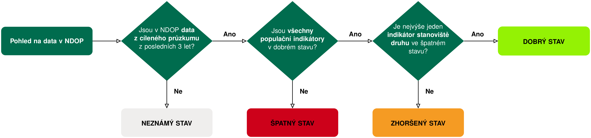
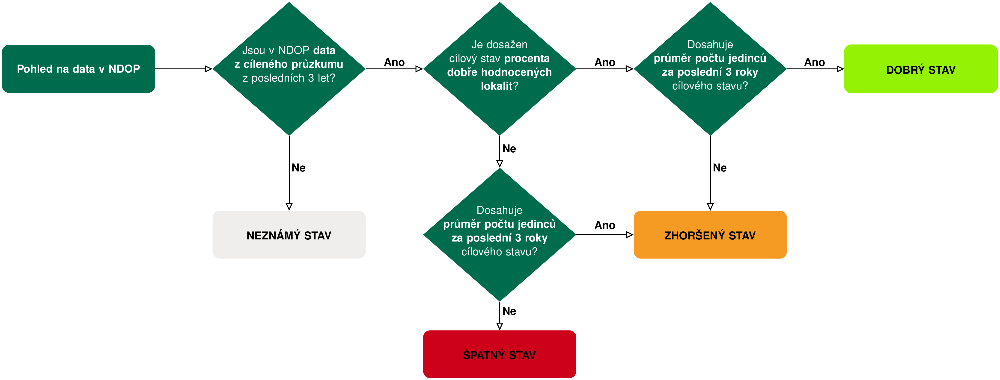

<!-- Tento soubor je GENEROVANY z met_ssEVL_SLOUCENE_teren_a_vyhodnocovani_obojziv_2024_zmeny.docx skriptem R/05_metodiky/52_metodika_docx_md.R. -->
<!-- Rucni zmeny se pri dalsim prevodu prepisi - upravujte zdrojovy .docx,
     nebo prevod zastavte a dal udrzujte jen tento Markdown. -->

1Česká zemědělská univerzita, Kamýcká 129, 165 00 Praha – Suchdol, 2Agentura ochrany přírody a krajiny ČR, Kaplanova 1931/1, 148 00 Praha – Chodov

Součástí metodiky je příloha 1: **Hodnocené indikátory pro jednotlivé druhy** a příloha 2: **Specifikace výběru reprezentativních ploch** pro sledování stavu jednotlivých druhů.

## Cíl sledování a metodiky vyhodnocování

Cílem metodiky sledování je poskytnout jednotný návod pro <u>systematický sběr dat o rozšíření, aktuálním stavu a trendech početností populací druhů / předmětů ochrany a stavu jeho stanovišť včetně ohrožujících faktorů, jakožto informací důležitých pro posouzení stavu druhu/předmětu ochrany v rámci dílčí lokality i sledovaného území.</u>

Cílem metodiky vyhodnocení stavu je poskytnout jednotný návod pro <u>vyhodnocení stavu druhu v rámci sledovaného území</u> na základě systematicky sbíraných dat o rozšíření, aktuálním stavu a trendech populací druhu a stavu jeho stanovišť, péče o ně a vlivu ohrožujících faktorů v rámci sledovaného území. Výsledky budou podkladem pro vyhotovení Hodnotících zpráv podle článku 17 Směrnice o stanovištích (92/43/EEC; §45f zákona 114/1992 Sb.), péče o druh jako předmět ochrany a jeho stanoviště a případně standardních datových formulářů <u>v rámci sledovaného území</u>.

Metodika terénních prací pro řešené druhy vychází z Metodik monitoringu obojživelníků (Jeřábková 2011, 2024), v obecné rovině pak z Metodiky sledování stavu EVL (Jeřábková & Fischer 2015) a Metodik monitoringu obojživelníků (Kolektiv 2006). Je tedy nutné (z odborných i finančních důvodů), aby monitoring druhů v rámci sledovaného území prováděla osoba znalá standardně používaných metod, ekologie sledovaného druhu i daného místa.

Jednotlivá území vymezena pro sledované druhy se liší svou rozlohou, počtem i uspořádáním jednotlivých typů biotopů, zjednodušeně vodních a terestrických. I přes komplexní nároky těchto druhů bude vodítkem pro výběr reprezentativních a sledovaných dílčích ploch (dále jen DP) v jednotlivých sledovaných územích, neboť standardní monitoring druhu (Jeřábková 2011) probíhá právě na nich.

Prakticky lze za samostatnou populaci považovat takovou, jež je od ostatních oddělená zřejmou bariérou, ať už antropogenní (dálnice, zástavba) či přírodní (větší vodní tok, horský hřeben), nebo je v dostatečné vzdálenosti (nedostupná) od další takové populace. Většina druhů obojživelníků vyskytujících se v Česku se zpravidla pohybuje do vzdálenosti <u>500–1000 m</u> od reprodukční nádrže (alespoň většina dané populace, jednotlivci mohou vykazovat přesuny i na delší vzdálenosti). Za dostačující vzdálenost mezi trvale sledovanými DP, aby je bylo možno považovat za samostatné populace nebo samostatné plochy z hlediska péče o stanoviště druhu (viz kapitola 1.2). V případě větších území je vhodnější vybírat od sebe vzdálenější DP, protože je pak větší šance, že reprezentují samostatné populace. Pro menší území s více s tůněmi a třeba hlavním rybníkem je vhodné udělat dílčí plochy samostatně (rybník, skupina podobných tůní apod.).

## 1 Terénní sledování

<!-- -->

### 1.1 Sledované indikátory

#### Stav populace

- ***Přítomnost druhu.*** Je zohledňován záznam jakéhokoliv vývojového stádia (snůšek, pulců, juvenilů, subadultů i dospělců) zjištěný jakoukoli metodou na DP (vizuálně, poslech samců, podběrákem, živochytnými pastmi).

- ***Početnost druhu.*** Pokud je zaznamenána přítomnost druhu, je vždy zaznamenávána i jeho početnost. Zaznamenává se **výhradně počet skutečně zjištěných jedinců**, tj. slyšených (vokalizující samci u druhu Bombina bombina), spatřených (dospělci u všech ostatních druhů) nebo odchycených. Zjištěný počet se pro každou celou DP buď přesně zaznamená nebo zařadí do třídy: (i) jednotky (1–10), (ii) nižší desítky (11–50), (iii) vyšší desítky (51–100), (iv) stovky (101–1000), příp. (v) tisíce (1001+).

  - Číslo se vždy vztahuje pouze k pozorovaným (slyšeným, spatřeným, odchyceným) jedincům. **Početnost se nedopočítává o jedince, kteří pozorováni nebyli** (nejde o odhad celkové velikosti populace).

  - Ve třídách „stovky" a „tisíce" není přesné sečtení jedinců v terénu možné ani vyžadované; zařazení do třídy zde vychází z přibližného vyhodnocení počtu pozorovaných jedinců. I v těchto případech ale platí, že se hodnotí pouze jedinci skutečně zjištění, nikoliv dopočtená velikost populace.

  - Doplňkově mohou být zjišťovány počty dospělců i vývojových stádií (snůšek, pulců, larev, juvenilů, subadultů) pozorováním, odlovem podběrákem či pomocí živochytných pastí. I zde se zaznamenává pouze počet skutečně spatřených či odchycených jedinců.Doplňkově mohou být zjišťovány početnosti dospělců i vývojových stádií (snůšek, pulců, larev, juvenilů, subadultů) na základě pozorování, odlovu podběrákem či pomocí živochytných pastí.

  - V případě použití pastí je vždy uváděn jejich počet.

  - Je ale třeba odlišovat početnost zjištěnou na zjištěných doplňkově jinými metodami.

Výsledkem je:

1)  <u>hodnota počtu sledované jednotky (např. vokalizujích samců pro *Bombina bombina* či všech adultů u čolků)</u>, nikoliv potenciální celková velikost populace včetně samic atd., viz dále) <u>po jednotlivých DP</u>

2)  <u>celková početnost zaznamenaných dospělců</u> (zohlednění samic a dospělců zjištěných jinými metodami než poslechem) <u>po jednotlivých DP</u>.

- ***Rozmnožování, resp. přítomnost vývojových stádií***. Zaznamenává se reprodukce na DP, resp. zde byly zaznamenané snůšky, pulci, larvy a metamorfovaní jedinci, a to jakoukoliv metodou. Musí být doplněn údajem o početnosti (např. počet pulců). U druhu *Bombina bombina* jde o doplňkový indikátor, který je zaznamenáván nepovinně.

#### Stav habitatu

- **Stav vody.** Zaznamenává se míra zaplavení dna DP v procentech, kde 100 % odpovídá plně zaplavenému dnu, tj. zaplavení celé pánve v jejím maximálním rozsahu; 0 % odpovídá zcela vyschlé ploše. Maximální rozsah se v terénu odvozuje od morfologie pánve a od trvalých znaků nejvyšší hladiny (břehová hrana, linie bahenní vegetace, naplaveniny, obnažené kořeny). Hodnota se odhaduje vizuálně za celou DP; u členitých ploch se odhad provádí po částech a sečte. Kompletně suché dno se vždy zaznamenává jako „vyschlá“. Zaniklá plocha je taková, na jejímž bývalém dnu je pozorována vegetace v pokročilém stádiu sukcese (alespoň 50 vysoké dřeviny).

- **Průhlednost vody.** Zaznamenává se v centimetrech jako hloubka, v níž přestává být rozeznatelná Secchiho deska, případně kvalifikovaným odhadem, pokud deska není k dispozici. Měří se v nejhlubší dostupné části DP, ze stinné strany (ve vlastním stínu), bez předchozího rozvíření dna; u větších ploch se měří na dvou až třech místech a zaznamenává se průměr. Je-li deska viditelná až na dně, zaznamená se hloubka vody v místě měření s poznámkou „dno viditelné". Vždy se zaznamenává způsob zjištění (Secchiho deska / odhad) a poznámka o srážkové situaci, pokud v předchozích dnech došlo k přívalovým srážkám či splachu z okolí.

- **Zákal a zabarvení zákalu.** Zaznamenává se míra zákalu v kategoriích: bez zákalu / slabý / silný. Zároveň se zaznamenává převažující důvod zákalu. Posuzuje se ve vzorku odebraném do průhledné nádoby proti bílému pozadí, nikoliv pohledem na hladinu, aby záznam nebyl ovlivněn odrazem oblohy a osvětlením. Doplňkově se do poznámky uvádí zjevná příčina zákalu, je-li v terénu patrná.

- **Pokryvnost vegetace**. Zaznamenává se v procentech plochy vodní hladiny DP jako kolmý průmět všech makrofyt – ponořených, plovoucích i vynořených (včetně rákosin a dalších porostů zasahujících do vodní plochy). Vegetace se ověřuje pohledem, při zhoršené viditelnosti prohrábnutím podběrákem či hráběmi na několika místech.

- **Plocha s hloubkou menší než 50 cm**. Zaznamenává se v procentech aktuálně zaplavené plochy DP. Hloubka se ověřuje tyčí podběráku na několika místech po obvodu plochy a rozsah mělčiny se odhaduje podle vzdálenosti hranice 50 cm hloubky od břehové linie. Hodnota se vztahuje k aktuálnímu stavu při návštěvě a interpretuje se vždy spolu s indikátorem Stav vody. Indikátor není sledován v období během do tří dnů po silných srážkách.

- **Zastínění vodní hladiny okolní vegetací.** Zaznamenává se v procentech plochy vodní hladiny DP jako kolmý průmět korun dřevin a vysoké břehové vegetace na hladinu. Hodnotí se vždy stav při plném olistění; při návštěvě mimo vegetační sezónu se zaznamenává průmět korun bez ohledu na aktuální olistění. Nezaznamenává se okamžitý stín daný polohou slunce v době návštěvy.

***Vymezení litorálu** (společné pro oba následující indikátory). Litorálem se rozumí mělkovodní zóna DP s hloubkou do 1 m tvořená zakořeněnou vodní vegetací (orobinec, rákos, ostřice a jiné). Vymezuje se tedy současně podle hloubky a podle přítomnosti porostu: části mělčiny bez zakořeněné vegetace ani porosty v hloubce nad 1 m do litorálu nespadají. Rozsah litorálu se v terénu odhaduje podle hranice porostu a ověřuje se hloubkou na několika místech po obvodu. Hloubka se vztahuje ke stavu při plném zaplavení DP, aby vymezení litorálu zůstalo mezi návštěvami i mezi sezónami stálé a bylo srovnatelné.*

- **Zastínění litorálu okolní vegetací.** Zaznamenává se podíl plochy litorálu zastíněný okolní vegetací, a to kolmým průmětem korun dřevin a vysoké břehové vegetace na litorál. Hodnota se zařazuje do tříd, kdy 100 % odpovídá prakticky plně zastíněnému litorálu. Hodnotí se stav při plném olistění; při návštěvě mimo vegetační sezónu se zaznamenává průmět korun bez ohledu na aktuální olistění a nezaznamenává se okamžitý stín daný polohou slunce v době návštěvy. Hodnota se zaznamenává odděleně od indikátoru Zastínění vodní hladiny okolní vegetací — obě se zpravidla liší, protože zastínění bývá soustředěno právě do příbřežního pásu.

- **Zaplavení litorálu.** Zaznamenává se podíl plochy litorálu, který je v době návštěvy zaplaven vodou; 76–100 % odpovídá litorálu zaplavenému prakticky v celém rozsahu, 1–25 % litorálu převážně suchému, 0% odpovídá suchému litorálu. Rozsah litorálu, k němuž se podíl vztahuje, zůstává stejný jako u předchozího indikátoru, tj. je vymezen porostem a hloubkou při plném zaplavení; zaznamenává se tedy, jaká část tohoto vymezeného pásu je aktuálně pod vodou. Hodnota se zaznamenává při každé návštěvě spolu s jejím datem. Do poznámky se uvádí, byla-li v obnažené části litorálu zjištěna obnažená snůška, uhynulé larvy nebo jiné doklady předchozího vyššího stavu vody. Indikátor není sledován v období během do tří dnů po silných srážkách.

- **Přítomnost nadměrného tlaku ryb**. Zaznamenává se v kategoriích: ano / ne / nelze vyloučit / nehodnoceno. Hodnota „ano" se zaznamenává při doloženém zjištění ryb v DP (prolov podběrákem či síťkou, odchyt do živochytných pastí, přímé pozorování ryb nebo jejich projevů) nebo při doložené informaci o rybí obsádce od hospodařícího subjektu. Hodnota „nelze vyloučit" se zaznamenává tam, kde ryby nebyly přímo zjištěny, ale monitorovatel má důvodné podezření na jejich působení; důvod se vždy uvádí do poznámky. Hodnota „nehodnoceno" se zaznamenává tam, kde plochu nebylo možné metodicky prověřit, což se týká zejména rybníků a velkých tůní. Vždy se zaznamenává použitá metoda ověření a v případě pastí jejich počet a doba expozice.

- **Manipulace s vodní hladinou**. Zaznamenává se ve Vlivech v části Voda. Zaznamenává se, zda v DP došlo ke snížení vodní hladiny v souvislosti s rybářským obhospodařováním či jiným využíváním plochy (např. vypuštění nádrže při rekonstrukci). Zvláštní důraz na sledování indikátoru je kladen v době vývoje snůšek (zpravidla duben až červenec). Do poznámky se uvádějí zjištěné doklady – obnažené dno, obnažené snůšky, uhynulé larvy, poloha hladiny vůči trvalým znakům.

- ***Nevysvětlitelné úhyny většího počtu jedinců obojživelníků.*** Zaznamenává se v kategoriích: ano / ne. Hodnota „ano" se zaznamenává při pozorovaném hromadném úhynu obojživelníků. V případě nálezů nevysvětlitelných úhynů nebo živých jedinců s možnými projevy nějakého onemocnění (léze na pokožce, její odlupování, změny chování, apatie atp.) je nutné tyto jedince nafotit a upozornit okamžitě příslušné regionální pracoviště AOPK ČR a již nenavštěvovat další lokalitu, aby nedošlo k případnému přenosu jakékoli nákazy. Je nutné obuv i materiál použitý k monitoringu nechat pořádně vyschnout nebo dezinfikovat.

### 1.2 Výběr reprezentativních ploch

Pro každý druh je dále uveden postup vymezení a výběru DP. Klíčové podmínky pro vymezení samostatné DP jsou:

- Podmínka 1:Management dílčí plochy. Sledování stavu dílčích lokalit je uskutečňováno s cílem poskytnout detailní informace o stavu populací a prostředí druhů. Z tohoto důvodu je klíčové jako samostatné DP plochy vymezovat území, která umožňují různé nastavení péče o stanoviště druhu. Jedná se tedy například o jednotlivé rybníky v rámci rybniční soustavy, dílčí soustavy malých tůní či lesní cestu s vyjetými kolejemi.

- Podmínka 2: Konektivita z pohledu sledovaného druhu. Většina druhů obojživelníků vyskytujících se v Česku se zpravidla pohybuje do vzdálenosti <u>500–1000 m</u> od reprodukční nádrže (alespoň většina dané populace, jednotlivci mohou vykazovat přesuny i na delší vzdálenosti). Za dostačující vzdálenost mezi trvale sledovanými DP, aby je bylo možno považovat za samostatné populace, lze tudíž považovat alespoň 500 m.

V první řadě jsou DP posuzovány dle podmínky 1, doplňkově dle podmínky 2.

Zákres nových i editace stávajících dílčích ploch probíhá přes webovou aplikaci: <https://aopkcr.maps.arcgis.com/apps/webappviewer/index.html?id=1ef08fa7b1f545f1aa83f75899bb7955>.

#### Bombina bombina (kuňka obecná)

Pro ochranu kuňky obecné jsou vyhlášeny desítky EVL a MZCHÚ. Dle jejich rozlohy a počtu VP se jedná o tři základní kategorie chráněných území, pro které je navržen následující rozsah monitoringu a způsob výběru sledovaných DP.

**(i)** Území vymezené pouze jako <u>jednotlivé DP</u> (typicky mělké rybníky s litorály, tůně či soustavy tůní v nivách řek, v pískovnách, v lomech či na výsypkách, ev. slepá ramena, požární nádrže či koupaliště) s jejich nejbližším okolím (např. EVL Rybník Strašidlo) nebo <u>jako několik (zpravidla do 5) DP</u> o celkové rozloze v řádech jednotek až nižších desítek ha (zpravidla do 20 ha včetně bezprostředního okolí, např. EVL Cihelenské rybníky či EVL Manušické rybníky).

**(ii)** Území vymezené jako <u>soubor několika (zpravidla více než 5) DP</u> včetně jejich okolí o celkové rozloze území v řádech <u>desítek až několika málo stovek ha</u>. Typickými zástupci takových území jsou často soustavy rybníků (např. EVL Vrbenské rybníky) či tůní a slepých ramen řek (např. EVL Týnecké mokřiny), ale i bývalá vojenská cvičiště (např. EVL Na Plachtě) nebo zatopené důlní propadliny (např. EVL Pražská pole).

V takovém případě je prvním krokem vymapování a lokalizace všech DP (včetně periodických) v rámci jedné denní návštěvy. Pokud je v rámci sledovaného území více než 10 DP, bude pro kontrolu přítomnosti a početnosti druhu vybráno nejméně 10 pro druh nejvhodnějších DP (trvalejší VP s perspektivním výskytem druhu, tj. umožňující úspěšné rozmnožování; skupiny tůní jsou hodnoceny jako jedny DP), ideálně v rámci celého území.

**(iii)** Území o rozlohách <u>stovek až tisíců ha</u>. Typicky jde o velkoplošná ZCHÚ, kde se vyskytují řádově nejméně desítky VP (či skupin takových VP), často poměrně vzdálených, tvořících s vysokou pravděpodobností samostatné populace. Vzhledem ke značné odlišnosti větších sledovaných území je pro každou z takovýchto území specifikován v tabulce v příloze této metodiky výběr DP.

Nejprve by měly být v daném území v rámci denní návštěvy vymapovány a lokalizovány pokud možno všechny trvalejší DP s perspektivním výskytem druhu. Současně by na všech těchto DP měla být zaznamenána alespoň přítomnost a početnost druhu. Během této první kontroly bude současně proveden výběr dále sledovaných DP, u kterých budou kromě přítomnosti a početnosti druhu v rámci této denní kontroly sledovány i indikátory stavu stanoviště druhu.

#### Bombina variegata (kuňka žlutobřichá)

V ČR jsou desítky chráněných území vymezených pro tento druh, které lze podle celkové rozlohy a počtu DP rozdělit do dvou kategorií. Zhruba polovinu sledovaných území představují menší území o rozlohách v řádu jednotek ha, zpravidla s výskytem jednotek (max. však nižších desítek) DP; ostatní území jsou větší, o rozlohách od zhruba 20 ha až po stovky ha, často s výskytem i vyšších desítek DP. Na obou těchto typech území je prvním krokem vymapování a lokalizace pokud možno <u>všech DP</u> (včetně periodických), které budou dále sledovány

Jediným opravdu rozsáhlým sledovaným územím, kde je předmětem ochrany kuňka žlutobřichá, je EVL Beskydy, o rozloze přes 120000 ha. Zde budou všechny indikátory zjišťovány pouze na min. 10 vybraných DP. Přednostně jsou sledovány takové DP, které byly již dříve monitorovány, a přítomnost druhu zde byla prokázána.

#### Lissotriton montandoni (čolek karpatský)

Vymezená chráněná území pro čolka karpatského se velmi liší svou rozlohou (řádově desítky až desetitisíce ha) i uspořádáním jednotlivých typů biotopů, zjednodušeně vodních a terestrických, včetně rovnoměrnosti výskytu druhu v rámci území.

Prvním krokem je vymapování a lokalizace pokud možno <u>všech DP</u> (včetně periodických), které budou dále sledovány.

#### Čolci rodu Triturus – T. cristatus (čolek velký), T. dobrogicus (č. dunajský) a T. carnifex (č. dravý)

Počet chráněných území vyhlášených pro jednotlivé druhy čolků rodu *Triturus* je odlišný. Pro čolka velkého jsou vyhlášeny desítky chráněných území, pro čolka dunajského a čolka dravého jednotky. U dvou vzácnějších druhů je tento výběr specifikován pro každé jednotlivé území, v případě čolka velkého je provedena kategorizace území podle jejich rozlohy, počtu a uspořádání DP.

##### Čolek velký

Jednotlivá území vymezené pro tento druh se liší svou rozlohou i uspořádáním jednotlivých typů biotopů (vodních i terestrických). Dle velikosti území a počtu DP se jedná o tři základní kategorie území, pro které je navržen následující rozsah monitoringu a způsob výběru sledovaných DP:

**(i)** Území vymezené pouze jako <u>jednotlivé spíše větší DP</u> (např. rybník) <u>nebo několik</u> (max. však 10) <u>spíše menších vzájemně blízkých VP</u> (typicky tůní) včetně bezprostředního okolí o celkové rozloze řádově jednotek ha. Příkladem takových území mohou být: EVL Darmyšl – pískovna, EVL Kerské rybníčky. U těchto území budou sledovány všechny zde nalezené DP vhodné pro reprodukci druhu.

**(ii)** Území vymezené jako <u>soubor několika větších DP či max. nižších desítek menších</u> VP (tůní) včetně jejich okolí o celkové rozloze v řádech max. desítek ha. Typickými zástupci takových území jsou často větší pískovny, vojenská cvičiště či soustavy rybníků, jako např. EVL CZ0323169 – Stříbro, vojenské cvičiště či CZ0523010 – Na Plachtě. V takovém případě je prvním krokem vymapování a lokalizace všech DP potenciálně vhodných pro rozmnožování druhu v rámci jedné denní návštěvy, které budou dále sledovány. Pokud je v rámci území takových DP více než 10, bude sledováno cca 10 pro druh nejvhodnějších DP (trvalejší DP s perspektivním výskytem druhu, tj. umožňující úspěšné rozmnožování), ideálně v rámci celého území; skupiny menších vodních ploch (tůní) jsou zpravidla sledovány jako jednu DP.

**(iii)** Území o rozlohách <u>stovek až tisíců ha</u>. Typicky jde o velkoplošná ZCHÚ, kde se vyskytují řádově nejméně desítky DP, často poměrně vzdálených. Vzhledem ke značné odlišnosti větších území je pro každou z nich specifikován výběr DP pro sledování, který je uveden v tabulce v příloze této metodiky. Nejprve by měly být v daném území vymapovány a lokalizovány pokud možno všechny trvalejší DP s perspektivním výskytem druhu. Během této první kontroly bude současně proveden výběr dále sledovaných DP.

##### Čolek dunajský

Pro tento druh jsou vymezené pouze dvě EVL: CZ0623031 – Vypálenky a CZ0624119 – Soutok – Podluží.

Specifikace výběru reprezentativních ploch pro sledování stavu čolka dunajského je uvedeno v příloze 2 této metodiky.

##### Čolek dravý

Pro tento druh je vymezeno několik území velmi podobných svou rozlohou (2–10 ha) i počtem DP. Vesměs se jedná o jednotlivé tůně či zatopené prostory v lomech. S ohledem na velikost území, počet DP i jejich výjimečnost budou sledovány všechny DP.

### 1.3 Terénní metodika

Termíny kontrol musí přizpůsobeny aktuálnímu průběhu počasí v daném roce a měly by proběhnout za vhodného počasí.

#### Bombina bombina (kuňka obecná)

Ke zjištění výše uvedených indikátorů je **potřeba nejméně dvou návštěv za rok**, a to v období páření (zpravidla duben – červen).

<u>První kontrola je denní</u> a slouží k identifikaci a lokalizaci trvalejších DP (sledován min.) včetně výběru a popisu dále sledovaných DP.

<u>Druhá noční kontrola</u> je zaměřená zejména na přítomnost a početnost druhu na základě hlasových projevů samců na vybraných DP; dle možností mohou být sledovány i další indikátory).

**Pokud je lokalita známá, je možné pořadí návštěv otočit.** Je to vhodné především pro zaznamenání průhlednosti v reprezentativnějším období. Pokud nebude v průběhu prvních dvou návštěv přítomnost kuňky na lokalitě zjištěna a pokud existuje šance, že by se druh zde mohl vyskytovat, proběhne doplňkově ještě třetí návštěva v noci.

#### Bombina variegata (kuňka žlutobřichá)

Ke zjištění výše uvedených indikátorů je **potřeba nejméně dvou návštěv za rok** (jedna povinná jarní a druhá povinná letní).

<u>První kontrola na jaře</u> a to v období páření (zpravidla duben až květen) <u>je denní</u> a slouží k identifikaci a lokalizaci DP, dále pak k zaznamenání přítomnosti a početnosti druhu,  sledování stavu stanoviště druhu i k zaznamenání rozmnožování. Pokud v rámci této kontroly druh není v DP zjištěn, proběhne na jaře ještě jedna kontrola (může být i noční).

Po jarní kontrole (příp. po dvou jarních kontrolách) proběhne ještě <u>letní kontrola</u> (červen až srpen) k opětovnému zaznamenání přítomnosti a početnosti druhu, eventuelně i rozmnožování a k sledování stavu stanoviště druhu, zejména pak vysychání DP.

#### Lissotriton montandoni (čolek karpatský)

Ke zjištění sledovaných indikátorů je **potřeba dvou až pěti návštěv za rok**, podle toho, jestli byly využity pasti a jestli byl druh zaznamenán během první návštěvy.

<u>První kontrola</u> (zpravidla duben až květen) <u>je denní</u> a slouží především k identifikaci a lokalizaci DP, dále pak k zaznamenání přítomnosti a početnosti druhu (vizuálně či podběrákem) a k sledování stavu stanoviště druhu, na vybraných DP. Pokud jsou pro zjištění využity živochytné pasti, proběhne v rámci této kontroly i jejich instalace. Druhý den (příp. po několika hodinách, zvláště když je past instalována večer a chytá v noci) jsou pasti kontrolovány a deinstalovány.

**Počet umístěných pastí je od 3 až 5, podle velikosti a členitosti DP** na místech s očekávaným výskytem čolků (v blízkosti vodní vegetace, úkrytů). Pro každou DP je nutné dodržovat každoročně fixní počet použitých pastí i při změně monitorovatele, a je-li to možné, přednostně také stejný typ pastí. Použitý typ pastí (hranol, deštník, jiná) je třeba zaznamenat. Odchýlení od stanoveného počtu pastí není možné z důvodu standardizace monitoringu v čase.

Pokud v rámci této první (dvoj)kontroly druh v DP není zjištěn, proběhne na jaře ještě jedna kontrola (může být i noční, na lokalitě obvyklou metodikou) pro zjištění přítomnosti a početnosti druhu. Po jarní kontrole proběhne ještě <u>letní kontrola</u> (červen až srpen) k opětovnému zaznamenání přítomnosti a početnosti druhu a především rozmnožování a k sledování stavu stanoviště druhu, zejména pak vysychání DP.

#### Čolci rodu Triturus – T. cristatus (čolek velký), T. dobrogicus (č. dunajský) a T. carnifex (č. dravý)

Ke zjištění sledovaných indikátorů je **potřeba dvou až pěti návštěv za rok**, podle toho, jestli byly využity pasti a jestli byl druh zaznamenán během první návštěvy.

<u>První kontrola</u> (zpravidla duben až květen) <u>je denní</u> a slouží především k identifikaci a lokalizaci DP, dále pak k zaznamenání přítomnosti a početnosti druhu (vizuálně či podběrákem) a k sledování stavu stanoviště druhu, na vybraných DP.

V rámci této kontroly proběhne i instalace živochytných pastí. Druhý den ráno (příp. po několika hodinách, pokud jsou pasti instalovány od soumraku do svítání, tzn. odchyt probíhá za tmy) jsou pasti kontrolovány a deinstalovány. **Počet umístěných pastí je od 3 až 5, podle velikosti a členitosti DP** na místech s očekávaným výskytem čolků (v blízkosti vodní vegetace, úkrytů). Pro každou DP je nutné dodržovat každoročně fixní počet použitých pastí i při změně monitorovatele, a je-li to možné, přednostně také stejný typ pastí. Použitý typ pastí (hranol, deštník, jiná) je třeba zaznamenat.

Pokud v rámci této první (dvoj)kontroly druh na DP není zjištěn, proběhne na jaře ještě jedna kontrola (může být i noční, na lokalitě obvyklou metodikou) pro zjištění přítomnosti a početnosti druhu.

Po jarní kontrole proběhne ještě <u>letní kontrola</u> (červen až srpen) k opětovnému zaznamenání přítomnosti a početnosti druhu a především rozmnožování a k sledování stavu stanoviště druhu, zejména pak vysychání DP.

### 1.4 Prevence zavlečení patogenů

Při terénních práci je nutné postupovat v souladu s pokyny (DOPLNIT PO FINALIZACI SITACI) vycházejících z Metodiky komplexní ochrany obojživelníků v souvislosti s nově se šířícími infekčními nemocemi (Vojar a kol. 2023).

### 1.5 Ukládání dat v systémech AOPK ČR

Sledované **indikátory** a **fotodokumentace lokality a druhu** jsou standardně zadávány do Nálezové databáze ochrany přírody pomocí **aplikace ESRI ArcGIS Survey123**.

## 2 Vyhodnocení stavu

V následujícím přehledu je pro každý hodnocený indikátor definován postup analýzy sebraných dat. Indikátory jsou rozděleny do dvou skupin, na populační indikátory a stanoviště druhu. Každý  indikátor je hodnocen samostatně.

Pro každý druh se vyhodnocují jiné indikátory a ty mohou mít i jiné limitní hodnoty. Přehled těchto indikátorů a limitů je uveden v příloze 1.

### 2.1 Hodnocení stavu druhu na úrovni dílčí plochy

#### Stav populace (klíčové indikátory)

Limitní hodnoty jsou popsány v tabulce Přílohy 1. Pro každý indikátor jsou pro danou DP ve sledovaném roce agregovány všechny zaznamenané hodnoty. Do celkového hodnocení druhu na DP za daný rok vstupuje nejvyšší pozorovaná hodnota.

- **Přítomnost druhu.** Předmětem hodnocení je <u>přítomnost druhu</u> v daném roce na sledované DP. Za nepříznivý stav se považuje pouze negativní záznam nebo záznam s počtem 0; DP bez záznamu se nehodnotí.

<!-- -->

- **Změna početnosti druhu**. Předmětem hodnocení je <u>porovnání odhadované početnosti druhu</u>. Tento indikátor je založen na porovnání odhadovaných počtů vokalizujících samců nebo dospělců v rámci sledované DP. Početnost je odhadována pro každou DP na šestistupňové škále – absence (hodnota 0) x jednotky (1) x nižší desítky (2) x vyšší desítky (3) x stovky (4) x tisíce (5). Hodnocenou jednotkou je počet vokalizujících samců u *Bombina bombina*, u ostatních druhů jsou jednotkou dospělci; do hodnocení vstupuje nejvyšší kategorie zjištěná na DP v dané sezóně. Nepříznivým stavem je pokles o více než jednu kategorii oproti referenční hodnotě, kterou je poslední předchozí roku s cíleným monitoringem na téže DP.

- **Prokázaná reprodukce druhu – přítomností vývojových stádií**. Předmětem hodnocení je prokázaný výskyt snůšek, pulců, larev či juvenilních jedinců v rámci DP. Nepříznivým stavem je, není-li reprodukce doložena ani jednou ze tří posledních sezón s monitoringem dané DP. Pro kuňku obecnou (*Bombina bombina*) jde o doplňkový indikátor, zaznamenáván jen dobrovolně.

#### Stav stanoviště druhu

Limitní hodnoty jsou popsány v tabulce Přílohy 1. Pro každý indikátor jsou pro danou DP ve sledovaném roce agregovány všechny zaznamenané hodnoty. Do celkového hodnocení druhu na DP za daný rok vstupuje nejhorší pozorovaná hodnota. Stačí tedy jedno překročení limitní hodnoty ve sledovaném roce a indikátor je hodnocen ve špatném stavu.

- **Nadměrný tlak ryb.** Ryby jsou zásadním predátorem vajíček a larev obojživelníků; mimořádně citlivé jsou volně plovoucí larvy čolků rodu *Triturus*, které nemají účinné únikové ani obranné chování a z rybničních ploch s vyšší obsádkou zpravidla mizí úplně. Negativně působí i drobné nepůvodní druhy (*Carassius gibelio,* *Pseudorasbora parva*), které navíc přispívají k zákalu a úbytku ponořené vegetace. Nepříznivá je proto nejen vysoká obsádka hospodářských ryb, ale i přítomnost rybí obsádky v drobných tůních, které by za přirozených podmínek zůstaly bezrybé.

- **Manipulace s vodní hladinou.** Rychlé snížení hladiny v průběhu rozmnožování obnažuje snůšky a odřezává larvy od vodní plochy, letní výlov či vypuštění před dokončením metamorfózy může zlikvidovat celou reprodukční kohortu. Naopak manipulace prováděná mimo reprodukční období je legitimním a často žádoucím nástrojem péče (zejména k redukci rybí obsádky). Hodnotí se tedy manipulace od dubna do července.

- **Pravidelné vysychání vodních ploch.** Je hodnoceno v kontextu posledních tří let. Indikátor je hodnocen ve špatném stavu, pokud vodní plocha vyschla v každém ze tří posledních hodnocených let. Zároveň je periodické vysychání klíčovým mechanismem, který udržuje vodní plochy bez ryb a bez stabilních populací dravého vodního hmyzu, a je proto pro většinu cílových druhů spíše příznivé.

- **Pokryvnost vodní vegetace.** Ponořená a plovoucí vegetace slouží jako substrát pro kladení vajíček (čolci vajíčka jednotlivě zabalují do listů ponořených rostlin), jako úkryt larev před predátory a jako prostředí s vysokou nabídkou potravy. Nepříznivé jsou pro většinu druhů oba extrémy: plocha bez vegetace neposkytuje místa ke kladení ani úkryt, zatímco úplné zarostení hladiny vede k zástinu, nočnímu poklesu kyslíku a k zániku volné vodní plochy potřebné pro námluvy čolků. Optimum proto leží ve středních hodnotách pokryvnosti. Výjimkou je *Bombina variagata*, která pro rozmnožování vyhledává tůně v ranných sukcesních stádiích.

- **Průhlednost vody.** Průhlednost je souhrnným ukazatelem trofie, míry rozvíření dna rybami a rozvoje fytoplanktonu, a nepřímo tak indikuje kvalitu prostředí pro vývoj larev. Přímý význam má pro čolky, jejichž námluvy i lov jsou vizuální. Trvalý zákal navíc omezuje ponořenou vegetaci a s ní i nabídku míst ke kladení a úkrytů.

- **Zastínění litorálu okolní vegetací.** Osluněný litorál se rychleji prohřívá, což urychluje vývoj larev a zvyšuje pravděpodobnost dokončení metamorfózy v rámci sezóny; to je zásadní zejména pro druhy mělkých a rychle se prohřívajících tůní (*Bombina* spp.). Silné zastínění vývoj zpomaluje, potlačuje ponořenou vegetaci a spolu se zvýšeným opadem přispívá k deficitu kyslíku. Zastínění se hodnotí pro litorál; dřeviny v okolí plochy naopak mohou představovat kvalitní terestrické prostředí.

- **Plocha s hloubkou menší než 50 cm.** Mělčiny jsou nejrychleji se prohřívající částí vodní plochy a pro řadu cílových druhů představují hlavní prostor pro kladení a vývoj larev. Zároveň jsou hůře dostupné pro ryby a mírně skloněné břehy usnadňují juvenilům opuštění vody. Absence mělčin (strmé břehy, technicky upravené nádrže) je nepříznivá i tehdy, je-li plocha jinak vyhovující; rozsah mělčin je však třeba posuzovat spolu s rizikem předčasného vyschnutí.

- **Úhyn obojživelníků.** Zaznamenaný úhyn upozorňuje na akutní ohrožení, které se v ostatních indikátorech stavu biotopu neprojeví – typicky mortalitu na komunikacích při migraci, důsledky rychlé manipulace s hladinou, znečištění nebo infekční onemocnění. Hromadný úhyn jedněch vývojových stádií nebo jednoho druhu je varovným signálem chytridiomykózy či ranavirózy a vyžaduje samostatné šetření. Opakovaný úhyn navíc naznačuje, že lokalita může fungovat jako ekologická past.

Způsob hodnocení je zřejmý z Tab. 1. Pokud je jeden klíčový populační indikátor hodnocen v nepříznivém stavu, je i druh v rámci DP hodnocen ve špatném stavu. Pokud jsou klíčové (populační) indikátory hodnoceny dobře, ale hodnocení alespoň 2 stanovištních indikátorů je negativní, je celkové hodnocení označeno jako zhoršené. Dobrý stav lokality nastává, pokud jsou klíčové indikátory hodnoceny příznivě a nepříznivý je maximálně 1 indikátor stanoviště druhu. Indikátor se hodnotí pouze, jsou–li dostupné informace k jeho hodnocení.

Tabulka 1:

| počet špatně hodnocených populačních indikátorů | počet špatně hodnocených stanovištních indikátorů | **celkový stav** |
|----|----|----|
| max 0 | 0 - 1 | **dobrý** |
| max 0 | min 2 | **zhoršený** |
| min 1 | \- | **špatný** |

### 2.2 Hodnocení stavu druhu na úrovni sledovaného území

Hodnocení stavu druhu na úrovni sledovaného území se sestává z kombinace dvou indikátorů. Jsou-li oba indikátory hodnoceny v dobrém stavu, je celkový stav dobrý. Pokud je právě jeden z indikátorů ve špatném stavu, je celkový stav zhoršený. Špatný celkový stav druhu v rámci území nastává, pokud jsou oba indikátory hodnoceny jako špatné.

**Procento dobře hodnocených dílčích ploch.** Jedná se o procento počtu dobře hodnocených DP vůči celkovému počtu vyhodnocených DP:

*počet DP v dobrém stavu / počet DP v dobrém, zhoršeném či špatném stavu \* 100*

Lokality, jejichž stav je hodnocen jako neznámý do výpočtu nevstupují.

**Početnost populace.** Předmětem hodnocení je součet maximálních početností v zaznamenaných na každé DP v daném roce. V případě, že pro danou DP existuje záznam relativní početnosti, převádí se na odpovídající hodnotu mediánu dané kategorie dle [převodní tabulky](https://github.com/BiodivMonCZ/host_naturecz/blob/main/Data/Input/cis_pocet_kat.csv) (např. 500 jedinců pro kategorii *stovky*). Limitní hodnotou je v případě hodnocení stavu předmětů ochrany EVL revidovaný cílový stav pro dané území, který je evidován v ISOP. V případě hodnocení předmětů ochrany MZCHÚ jde o cílovou hodnotu uvedenou v platném plánu péče. Limitní hodnoty jsou tedy u všech druhů specifické pro každé území.

Tabulka 2:

| procento dobře hodnocených dílčích lokalit | počet jedinců (klouzavý průměr za poslední 3 roky) | **celkový stav** |
|----|----|----|
| min 70 % | cílový stav splněn | **dobrý** |
| min 70 % | cílový stav nesplněn | **zhoršený** |
| méně než 70 % | cílový stav splněn | **zhoršený** |
| méně než 70 % | cílový stav nesplněn | **špatný** |

## Příloha 1: Hodnocené indikátory pro jednotlivé druhy na úrovni dílčích ploch

| **INDIKÁTOR** | **BBOM** | **BVAR** | **LMON** | **TRITURUS** |
|----|----|----|----|----|
| přítomnost druhu | musí být výskyt | musí být výskyt | musí být výskyt | musí být výskyt |
| porovnání odhadované početnosti | špatně je pokles kategorie o více než 1 kategorii | špatně je pokles kategorie o více než 1 kategorii | špatně je pokles kategorie o více než 1 kategorii | špatně je pokles kategorie o více než 1 kategorii |
| zaznamenávání reprodukce a vývojových stadií | doplňkově | reprodukce aspoň 1x za 3 roky | reprodukce aspoň 1x za 3 roky | reprodukce aspoň 1x za 3 roky |
| nadměrný tlak ryb | špatně je záznam | špatně je záznam | špatně je výskyt | špatně je výskyt |
| manipulace s vodní hladinou | špatně je záznam |   | špatně je výskyt | špatně je výskyt |
| pravidelné vysychání vodních ploch | špatně záznam ve všech třech letech po sobě | špatně výskyt ve všech třech letech po sobě | špatně výskyt ve všech třech letech po sobě | špatně výskyt ve všech třech letech po sobě |
| zastoupení vodní vegetace |   | špatně nad 50% |   | špatně je pod 1% a nad 75% |
| průhlednost vody | špatně je pod 50cm |   |   | špatně pod 50cm |
| zastínění litorálu okolní vegetací | špatně nad 75% | špatně nad 75% |   |   |
| plocha s hloubkou menší než 50 cm | špatně je pod 25% | špatně je pod 75% | špatně je pod 75% | špatně je pod 25% |
| úhyn obojživelníků | špatně výskyt | špatně výskyt | špatně výskyt | špatně výskyt |

## Příloha 2: Specifikace výběru reprezentativních ploch pro sledování stavu jednotlivých druhů v daných EVL

| KOD | NAZEV | DRUH | DÍLČÍ PLOCHY |
|----|----|----|----|
| CZ0213001 | Nový rybník u Kačiny | *Bombina bombina* | 1 |
| CZ0213004 | Rybník Starý u Líchov | *Bombina bombina* | 1 |
| CZ0213005 | Šáchovec | *Bombina bombina* | 1 |
| CZ0213008 | Bezděkovský lom | *Triturus cristatus* | 1 |
| CZ0213013 | Březnice - Oblouček | *Bombina bombina* | 2 |
| CZ0213017 | Dražská Koupě | *Bombina bombina* | 2 |
| CZ0213028 | Kalivody | *Bombina bombina* | 3 |
| CZ0213029 | Kalspot | *Triturus cristatus* | 4 |
| CZ0213038 | Kyšice - Kobyla | *Triturus cristatus* | 4 |
| CZ0213047 | Minartice | *Bombina bombina* | 2 |
| CZ0213058 | Lom na Plachtě | *Bombina bombina* | 1 |
| CZ0213061 | Týnecké mokřiny | *Bombina bombina* | cca 10 |
| CZ0213064 | Rožmitál pod Třemšínem | *Triturus cristatus* | 5 |
| CZ0213066 | Rybník Vočert a Lazy | *Bombina bombina* | 3 |
| CZ0213071 | Slavkov | *Bombina bombina* | 1 |
| CZ0213077 | Suchdolský rybník | *Triturus cristatus* | 1 |
| CZ0213081 | Vápenické jezero | *Bombina bombina* | 1 |
| CZ0213082 | Velký Raputovský rybník | *Bombina bombina* | 2 |
| CZ0213082 | Velký Raputovský rybník | *Triturus cristatus* | 2 |
| CZ0213084 | Vlčkovice - Dubský rybník | *Bombina bombina* | 1 |
| CZ0213086 | Aglaia | *Triturus cristatus* | 9 |
| CZ0213512 | Skočová - pískovna | *Bombina variegata* | 1 |
| CZ0213783 | Felbabka | *Bombina variegata* | 1 |
| CZ0213784 | Horní a Dolní obděnický rybník | *Bombina bombina* | 5 |
| CZ0213785 | Horní solopyský rybník | *Bombina bombina* | 2 |
| CZ0213787 | Hrachoviště | *Bombina variegata* | 1 |
| CZ0213789 | Jablonná - mokřad | *Bombina bombina* | 2 |
| CZ0213790 | Javůrek | *Triturus cristatus* | 1 |
| CZ0213791 | Jezera | *Bombina bombina* | 2 |
| CZ0213794 | Kerské rybníčky | *Triturus cristatus* | 1 |
| CZ0213822 | V Hlinišťatech | *Bombina variegata* | 1 |
| CZ0213822 | V Hlinišťatech | *Triturus cristatus* | 1 |
| CZ0214006 | Milovice - Mladá | *Triturus cristatus* | 2 |
| CZ0214007 | Káraný - Hrbáčkovy tůně | *Triturus cristatus* | 11 |
| CZ0214009 | Libické luhy | *Bombina bombina* | 3 |
| CZ0214015 | Vůznice | *Bombina variegata* | 3 |
| CZ0313097 | Cepská pískovna a okolí | *Triturus cristatus* | 3 |
| CZ0313098 | Hliníř - Ponědrážka | *Triturus cristatus* | 6 |
| CZ0313103 | Lom Skalka u Sepekova | *Triturus cristatus* | 1 |
| CZ0313115 | Boukal | *Bombina bombina* | 2 |
| CZ0313116 | Radomilická mokřina | *Bombina bombina* | 1 |
| CZ0313119 | Rašeliniště Radlice | *Triturus cristatus* | 3 |
| CZ0313125 | Tábor - Zahrádka | *Bombina bombina* | 5 |
| CZ0313134 | Újezdec | *Bombina bombina* | 2 |
| CZ0313138 | Vrbenské rybníky | *Bombina bombina* | 8 |
| CZ0313815 | Malý Bukač | *Triturus cristatus* | 1 |
| CZ0314023 | Třeboňsko - střed | *Bombina bombina* | cca 10 |
| CZ0314639 | Rybníky u Lovětína | *Triturus cristatus* | 4 |
| CZ0323143 | Blovice | *Bombina variegata* | 1 |
| CZ0323144 | Bonětice | *Triturus cristatus* | 1 |
| CZ0323147 | Darmyšl - pískovna | *Triturus cristatus* | 1 |
| CZ0323149 | Kakejcov | *Triturus cristatus* | 1 |
| CZ0323158 | Osek - rybník Labutinka | *Bombina bombina* | 1 |
| CZ0323160 | Pocinovice | *Triturus cristatus* | 1 |
| CZ0323162 | Přeštice - V Hlinkách | *Bombina variegata* | 1 |
| CZ0323167 | Rokycany - vojenské cvičiště | *Bombina variegata* | cca 10 |
| CZ0323169 | Stříbro - vojenské cvičiště | *Bombina variegata* | cca 10 |
| CZ0323169 | Stříbro - vojenské cvičiště | *Triturus cristatus* | cca 10 |
| CZ0323478 | Třebýcinka u Bezděkova | *Bombina variegata* | 1 |
| CZ0323826 | Dobřany | *Bombina variegata* | cca 10 |
| CZ0413174 | Borecké rybníky | *Triturus cristatus* | 2 |
| CZ0413184 | Pískovna Erika | *Triturus cristatus* | 1 |
| CZ0413185 | Matyáš | *Triturus cristatus* | 7 |
| CZ0413190 | Ostrovské rybníky | *Triturus cristatus* | 9 |
| CZ0413193 | U sedmi rybníků | *Triturus cristatus* | 5 |
| CZ0413196 | Týniště | *Bombina bombina* | 1 |
| CZ0414127 | Hradiště | *Bombina bombina* | cca 10 |
| CZ0414127 | Hradiště | *Triturus cristatus* | cca 10 |
| CZ0423006 | Nebeský rybníček u Veselí | *Triturus cristatus* | 1 |
| CZ0423202 | Březina | *Triturus cristatus* | 3 |
| CZ0423206 | Dobrná | *Triturus cristatus* | 3 |
| CZ0423211 | Háj u Oseka | *Bombina bombina* | 2 |
| CZ0423215 | Kateřina - mokřad | *Bombina bombina* | 2 |
| CZ0423216 | Kopistská výsypka | *Bombina bombina* | cca 10 |
| CZ0423216 | Kopistská výsypka | *Triturus cristatus* | 7 |
| CZ0423228 | Strádovský rybník | *Bombina bombina* | 1 |
| CZ0423660 | Pražská pole | *Bombina bombina* | 9 |
| CZ0423660 | Pražská pole | *Triturus cristatus* | 9 |
| CZ0424125 | Doupovské hory | *Bombina bombina* | cca 10 |
| CZ0424125 | Doupovské hory | *Triturus cristatus* | cca 10 |
| CZ0513237 | Česká Lípa - mokřad v nivě Šporky | *Bombina bombina* | 3 |
| CZ0513238 | Cihelenské rybníky | *Bombina bombina* | 5 |
| CZ0513244 | Manušické rybníky | *Bombina bombina* | 7 |
| CZ0513249 | Prácheň - Zicht | *Triturus cristatus* | 1 |
| CZ0513257 | Stružnické rybníky | *Bombina bombina* | 4 |
| CZ0513505 | Dolní Ploučnice | *Bombina bombina* | 6 |
| CZ0520178 | Březinka | *Triturus cristatus* | 1 |
| CZ0523002 | Hluboký Kovač | *Bombina bombina* | 1 |
| CZ0523003 | Rybník Strašidlo | *Bombina bombina* | 1 |
| CZ0523005 | Tuří rybník | *Bombina bombina* | 3 |
| CZ0523010 | Na Plachtě | *Triturus cristatus* | 4 |
| CZ0523011 | Pod Rýzmburkem | *Triturus cristatus* | 1 |
| CZ0523265 | Červená Třemešná - rybník | *Bombina bombina* | 1 |
| CZ0523268 | Dubno - Česká Skalice | *Bombina bombina* | 1 |
| CZ0523276 | Kanice - lesní rybník | *Triturus cristatus* | 1 |
| CZ0523282 | Nadslav | *Bombina bombina* | 1 |
| CZ0523286 | Rybník Smrkovák | *Bombina bombina* | 1 |
| CZ0523287 | Rybník Spáleniště | *Triturus cristatus* | 1 |
| CZ0524045 | Zbytka | *Bombina bombina* | cca 3 |
| CZ0524048 | Byšičky | *Bombina bombina* | 2 |
| CZ0524050 | Halín | *Bombina bombina* | 2 |
| CZ0533002 | Malá Straka | *Bombina bombina* | 1 |
| CZ0533012 | Michnovka-Pravy | *Triturus cristatus* | 2 |
| CZ0533302 | Choltická obora | *Bombina bombina* | 5 |
| CZ0533308 | Bohdanečský rybník | *Bombina bombina* | cca 10 |
| CZ0533312 | Rybník Moře | *Bombina bombina* | 1 |
| CZ0533696 | Kochánovické rybníky a tůně | *Bombina bombina* | 4 |
| CZ0533696 | Kochánovické rybníky a tůně | *Triturus cristatus* | 4 |
| CZ0533697 | Rybník Strach | *Bombina bombina* | 1 |
| CZ0613003 | Maršovec a Čepička | *Bombina bombina* | 4 |
| CZ0613013 | Šilhánky | *Bombina bombina* | cca 5 |
| CZ0613319 | Ficků rybník | *Triturus cristatus* | 1 |
| CZ0613322 | Koupaliště u Bohuslavic | *Triturus cristatus* | 2 |
| CZ0613328 | Rašelinné jezírko Rosička | *Triturus cristatus* | 1 |
| CZ0613335 | U Borovné | *Bombina bombina* | cca 7 |
| CZ0613336 | V Kopaninách | *Bombina bombina* | 1 |
| CZ0613338 | Vetelské rybníky | *Bombina bombina* | 11 |
| CZ0613809 | Dívka | *Bombina bombina* | 7 |
| CZ0614052 | Rybníky u Rudolce | *Bombina bombina* | 4 |
| CZ0614057 | Znětínské rybníky | *Bombina bombina* | 3 |
| CZ0614058 | Rybníky V Pouštích | *Bombina bombina* | 4 |
| CZ0623010 | Hevlínské jezero | *Bombina bombina* | 1 |
| CZ0623011 | Tasovický lom | *Triturus carnifex* | 1 |
| CZ0623027 | Šumické rybníky | *Bombina bombina* | 4 |
| CZ0623030 | Vrbovecký rybník | *Bombina bombina* | 1 |
| CZ0623031 | Vypálenky | *Bombina bombina* | 3 |
| CZ0623031 | Vypálenky | *Triturus dobrogicus* | 10 |
| CZ0623046 | Trávní dvůr | *Bombina bombina* | 9 |
| CZ0623345 | Citonice - rybník Skalka | *Triturus carnifex* | 2 |
| CZ0623348 | Jankovec | *Bombina bombina* | 3 |
| CZ0623349 | Velický hliník | *Bombina variegata* | 1 |
| CZ0623357 | Mašovický lom | *Triturus carnifex* | 1 |
| CZ0623358 | Horní Mouřínovský rybník | *Bombina bombina* | 1 |
| CZ0623359 | Čekál | *Bombina bombina* | 2 |
| CZ0623360 | Podmolí - strouha | *Triturus carnifex* | 1 |
| CZ0623365 | Rakšické louky | *Bombina bombina* | 10 |
| CZ0623365 | Rakšické louky | *Triturus cristatus* | 7 |
| CZ0623366 | Střelická bažinka | *Triturus cristatus* | 2 |
| CZ0623367 | U Huberta | *Triturus cristatus* | 2 |
| CZ0623368 | Kaolinka | *Triturus carnifex* | 1 |
| CZ0623372 | Lom u Žerůtek | *Triturus carnifex* | 1 |
| CZ0623772 | Božický mokřad | *Bombina bombina* | 1 |
| CZ0623793 | Úvalský rybník | *Bombina bombina* | 2 |
| CZ0623799 | Drnholecký luh | *Bombina bombina* | cca 10 |
| CZ0623800 | Knížecí les | *Bombina bombina* | 1 |
| CZ0623801 | Přísnotický les | *Triturus cristatus* | 3 |
| CZ0624064 | Krumlovský les | *Triturus cristatus* | cca 10 |
| CZ0624070 | Hodonínská doubrava | *Bombina bombina* | cca 10 |
| CZ0624096 | Podyjí | *Triturus carnifex* | cca 10 |
| CZ0624099 | Niva Dyje | *Bombina bombina* | cca 10 |
| CZ0624119 | Soutok - Podluží | *Bombina bombina* | cca 10 |
| CZ0624119 | Soutok - Podluží | *Triturus dobrogicus* | cca 10 |
| CZ0624129 | Luční údolí | *Triturus cristatus* | 6 |
| CZ0713008 | Deylův ostrůvek | *Bombina bombina* | 1 |
| CZ0713008 | Deylův ostrůvek | *Triturus cristatus* | 1 |
| CZ0713383 | Ohrozim - Horka | *Triturus cristatus* | 1 |
| CZ0713385 | Písečná - mokřad | *Bombina variegata* | 1 |
| CZ0713394 | Dolní a Prostřední Svrčov | *Bombina bombina* | 5 |
| CZ0713397 | Zlaté Hory - Černé jezero | *Lissotriton montandoni* | 4 |
| CZ0713398 | Zlaté Hory - Zlaté jezero | *Bombina variegata* | 4 |
| CZ0713827 | Stará Červená Voda - lesní komplex | *Bombina variegata* | cca 10 |
| CZ0714073 | Litovelské Pomoraví | *Bombina bombina* | 9 |
| CZ0714073 | Litovelské Pomoraví | *Triturus cristatus* | 6 |
| CZ0714082 | Bečva - Žebračka | *Bombina bombina* | 5 |
| CZ0714085 | Morava - Chropyňský luh | *Triturus cristatus* | 8 |
| CZ0723406 | Chvalčov | *Triturus cristatus* | 1 |
| CZ0723409 | Kurovice - lom | *Triturus cristatus* | 3 |
| CZ0723410 | Mokřad Pumpák | *Triturus cristatus* | 1 |
| CZ0723412 | Mokřad u Slováckých strojíren | *Bombina variegata* | 1 |
| CZ0723413 | Ovčírka | *Bombina bombina* | 2 |
| CZ0723416 | Popovické rybníky | *Bombina variegata* | 4 |
| CZ0723423 | Skalky | *Bombina bombina* | 7 |
| CZ0723424 | Stonáč | *Bombina bombina* | 3 |
| CZ0723426 | Střížovice | *Bombina bombina* | 1 |
| CZ0723430 | Údolí Bánovského potoka | *Bombina variegata* | 1 |
| CZ0724089 | Beskydy | *Bombina variegata* | cca 10 |
| CZ0724089 | Beskydy | *Lissotriton montandoni* | cca 10 |
| CZ0724429 | Hostýnské vrchy | *Lissotriton montandoni* | cca 5 |
| CZ0813438 | Cihelna Kunín | *Triturus cristatus* | 6 |
| CZ0813439 | Děhylovský potok - Štěpán | *Bombina bombina* | 4 |
| CZ0813442 | Dolní Marklovice | *Bombina bombina* | 11 |
| CZ0813444 | Heřmanický rybník | *Triturus cristatus* | 11 |
| CZ0813445 | Heřmanovice | *Lissotriton montandoni* | cca 5 |
| CZ0813450 | Karlova Studánka | *Lissotriton montandoni* | 2 |
| CZ0813455 | Mokřad u Rondelu | *Triturus cristatus* | 1 |
| CZ0813457 | Niva Olše - Věřňovice | *Bombina variegata* | 5 |
| CZ0813460 | Osoblažský výběžek | *Bombina bombina* | 4 |
| CZ0813469 | Staré hliniště | *Triturus cristatus* | 1 |
| CZ0813472 | Suchá Rudná - zlatý lom | *Triturus cristatus* | 1 |
| CZ0813475 | Václavovice - pískovna | *Triturus cristatus* | 1 |
| CZ0814092 | Poodří | *Bombina bombina* | cca 10 |
| CZ0814092 | Poodří | *Triturus cristatus* | cca 10 |
| CZ0814093 | Hraniční meandry Odry | *Bombina variegata* | 3 |

## Otevřené komentáře z původního dokumentu

Komentáře, které byly v době převodu nevyřešené v souboru .docx. Jsou zde uvedeny, aby se převodem neztratily.

- **Lenka Jeřábková** (2026-08-20): Přidat pak parametr do Survey
   *k textu:* „Plocha s hloubkou menší než 50 cm. Zaznamenává se v procentech aktuálně zaplavené plochy DP. Hloubka se ověřuje tyčí podběráku na několika místech po obvodu plochy a rozsah mělčiny se odhaduje podle v“
- **Lenka Jeřábková** (2026-07-02): doplnit
   *k textu:* „Prevence zavlečení patogenů“
- **Jonáš Gaigr2** (2026-08-06): Dáme k doplnění Honzovi, až se vrátí?
   *k textu:* „Prevence zavlečení patogenů“
- **Lenka Jeřábková** (2026-08-06): Souhlas, budu ráda, kdyžtak k tomu mámě jaké materiály od Baláže a Jirky Vojara
   *k textu:* „Prevence zavlečení patogenů“

